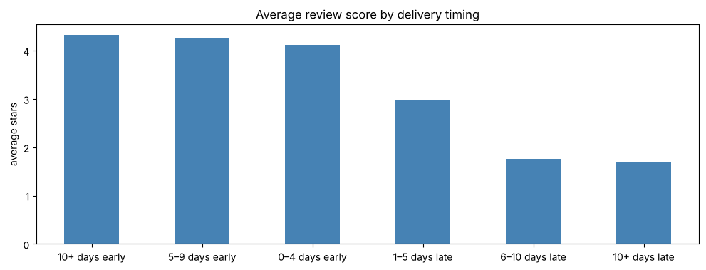
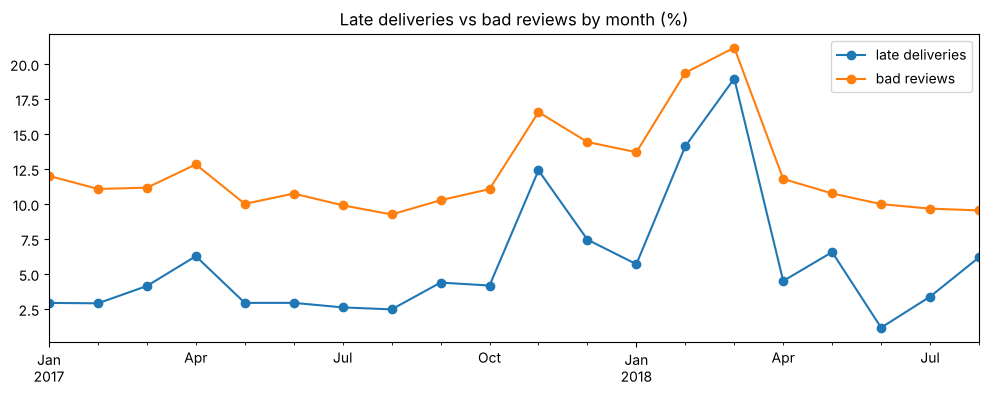
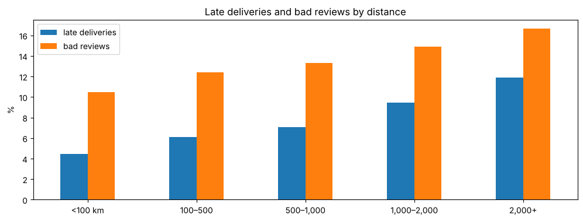
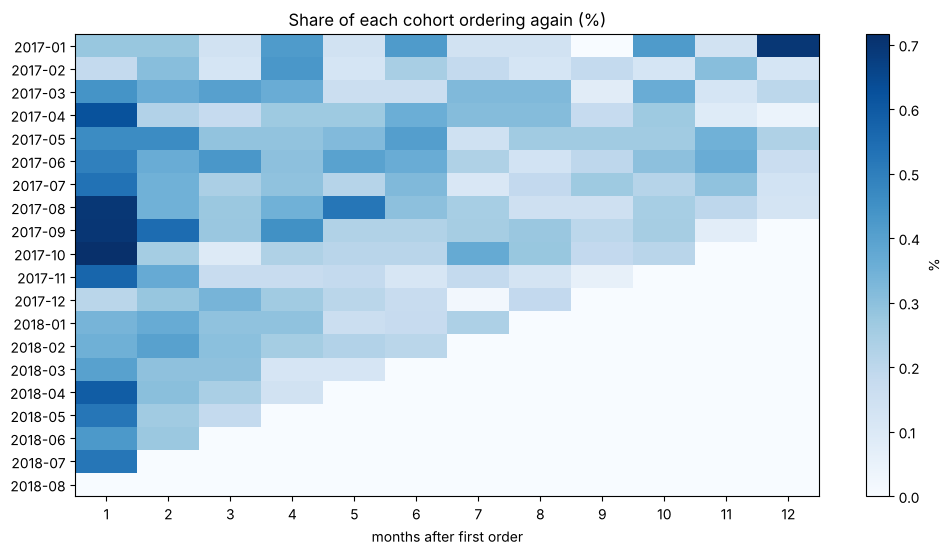

# AI Retail Analytics Copilot

An end-to-end AI project on real e-commerce data: data cleaning and analysis, machine learning models, sales forecasting, and an LLM assistant that answers business questions in plain English.

> **Status:** in progress. Phase 1 (data cleaning, exploratory analysis and retention analysis) is complete.

## The business problem

Business teams at an online marketplace need fast, reliable answers about customers, orders and deliveries, but every question needs an analyst to write SQL. This project builds a **Copilot** that answers questions such as:

- *"Which categories earned the most revenue last quarter?"* → writes and runs SQL
- *"Which orders are likely to get a bad review?"* → uses a classification model
- *"What will sales look like next month?"* → uses a forecasting model
- *"What kinds of customers do we have?"* → uses customer segmentation

## Data

[Brazilian E-Commerce Public Dataset by Olist](https://www.kaggle.com/datasets/olistbr/brazilian-ecommerce): about 99,000 real, anonymised orders placed between 2016 and 2018, spread across 9 linked tables (orders, items, customers, sellers, products, payments, reviews, geolocation, category names).

The data is real and messy: structural and genuine missing values, impossible dates, duplicate reviews, a batch system update that faked delivery dates, incomplete product listings and wrong coordinates. Every cleaning decision is documented in notebook 01.

## Key findings so far

**1. Late deliveries are the biggest driver of bad reviews.** Late orders get a 1–2 star review 63% of the time vs 9% for on-time orders, and the score falls the later an order arrives.



**2. Month by month, bad reviews track late deliveries (correlation 0.94).** The two spikes are the Black Friday 2017 surge and a Feb–Mar 2018 crisis, when nearly 1 in 5 orders arrived late.



**3. Distance drives delays.** 60% of sellers are in São Paulo; orders shipped over 2,000 km take 18 days vs 5 days under 100 km, and are late almost three times as often.



**4. Orders split across several sellers get bad reviews 47% of the time**, even when they arrive on time.

**5. Delivery promises are padded:** a median of 23 days promised vs 10 days to deliver.

**6. Only 2.15% of customers ever come back**, and a bad first experience is not the main reason.



**Recommendations:** ship multi-seller orders together (or warn customers), add sellers or warehouses outside São Paulo, set realistic promises for far-away states, investigate last-mile delivery in Rio de Janeiro, and add carrier capacity before peak periods.

## Notebooks

| Notebook | What it covers |
| --- | --- |
| [01 · Data cleaning and EDA](01_data_cleaning_and_eda.ipynb) | Missing and impossible values, outliers, the reliable time window, drivers of bad reviews, payments, geography; builds the clean master table |
| [02 · Customer retention and features](02_customer_retention_and_features.ipynb) | Repeat customers, cohort retention, the churn target, log transforms |

## Roadmap

- [x] Data cleaning and exploratory analysis
- [x] Customer retention analysis
- [ ] Customer segmentation (RFM and K-Means)
- [ ] Bad-review prediction and churn models
- [ ] Sales forecasting
- [ ] Text-to-SQL assistant with RAG (LLM)
- [ ] AI agent that routes questions to the right tool
- [ ] Fine-tuning a small SQL model (LoRA)
- [ ] Deployment (FastAPI, Docker) and live demo

## Repository structure

```
├── 01_data_cleaning_and_eda.ipynb            # notebook 1: cleaning, EDA, master table
├── 02_customer_retention_and_features.ipynb  # notebook 2: retention, churn target, transforms
├── *.png                                     # charts used in this README
├── requirements.txt
└── README.md
```

The raw data is not stored in this repository (see below).

## How to run

1. Download the dataset from [Kaggle](https://www.kaggle.com/datasets/olistbr/brazilian-ecommerce). In Google Colab, put the 9 CSV files in the Drive folder `MyDrive/Olist/`. To run locally, put them in a `data/` folder one level above this repository (the notebooks read `../data/`).
2. Install the requirements: `pip install -r requirements.txt`
3. Run the notebooks in order. Notebook 01 creates `master_orders.csv` in the same data folder, which notebook 02 uses.

## Tools

Python, pandas, NumPy, Matplotlib, Google Colab. Coming next: scikit-learn, BigQuery, LLM APIs, LangChain/LangGraph, FastAPI, Docker.
